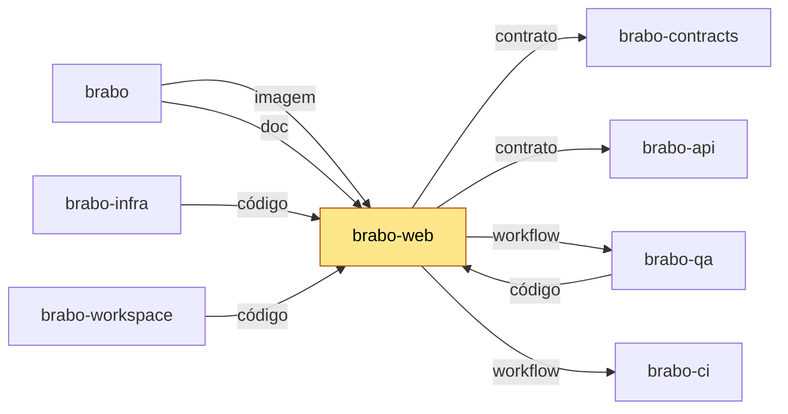

# brabo-web

[](https://github.com/viralabs-dev/brabo-web/actions/workflows/ci.yml?query=branch%3Adev)
[](https://github.com/viralabs-dev/brabo-web/actions/workflows/ci.yml?query=branch%3Amain)
[](https://github.com/viralabs-dev/brabo-web/tags)
[](https://github.com/viralabs-dev/brabo-web/releases/latest)
[](LICENSE)
[](https://viralabs-dev.github.io/brabo/prd/)
[](https://ko-fi.com/daneiel)

Interface web do Brabo: as telas do produto no navegador.

## Para que existe

Este repo é a camada de tela do Brabo: as telas em que a pessoa acompanha projetos, sessões e configurações, em pt-BR (idioma fonte), en, ru e zh-Hans, sobre um design system próprio em `design/`. Fica separado da API e do engine porque o Brabo tem um repo por camada (ADR 0252).

## Onde se encaixa

O web é consumido pelo `brabo` e pelo `brabo-infra`, e depende de contratos e da API fixada. A tabela e o diagrama abaixo são gerados do mapa dos 11 repos.

<!-- mapa:inicio -->
<!-- Gerado do repos.yml do brabo por brabo-ci:scripts/ci/mapa-dos-repos.ts. Não edite à mão. -->

**brabo-web** — Interface web (React 19, Vite) — telas, i18n e design system. Imagem publicada por tag, usada pelo brabo e pelo brabo-infra.

| repo | propósito | como é usado | depende de | é usado por |
|---|---|---|---|---|
| [brabo](https://github.com/viralabs-dev/brabo) | Porta de entrada do produto — documentação agregada, site, instalador e release. | Quem instala usa o `install.sh` e as imagens e o binário das tags de `componentes.json`; o brabo-infra o clona nas aferições cruzadas. | brabo-api (imagem, doc), brabo-engine (imagem, doc), brabo-web (imagem, doc), brabo-broker (imagem, doc), brabo-runner (imagem, doc), brabo-infra (imagem, código, doc), brabo-contracts (contrato, doc), brabo-ci (doc, workflow), brabo-qa (doc) | brabo-ci (contrato), brabo-infra (código), brabo-workspace (código) |
| [brabo-api](https://github.com/viralabs-dev/brabo-api) | API do produto (NestJS, Drizzle, PostgreSQL/pgvector) — schema, RBAC, LLM, metering e gates. | Imagem publicada por tag e consumida pelo brabo e pelo brabo-infra; o brabo-web, o brabo-engine e o brabo-qa leem o código ou o `openapi.json` dele. | brabo-contracts (contrato), brabo-infra (código), brabo-qa (workflow), brabo-ci (workflow) | brabo (imagem, doc), brabo-engine (código), brabo-web (contrato), brabo-contracts (contrato), brabo-infra (código), brabo-qa (código), brabo-workspace (código) |
| [brabo-engine](https://github.com/viralabs-dev/brabo-engine) | Engine (Elixir/OTP, Phoenix, Oban) — agentes, sessões, gates e roteamento de runners. | Imagem publicada por tag, usada pelo brabo e pelo brabo-infra. | brabo-contracts (contrato), brabo-api (código), brabo-runner (código), brabo-qa (workflow), brabo-ci (workflow) | brabo (imagem, doc), brabo-infra (código), brabo-qa (código), brabo-workspace (código) |
| **brabo-web** | Interface web (React 19, Vite) — telas, i18n e design system. | Imagem publicada por tag, usada pelo brabo e pelo brabo-infra. | brabo-contracts (contrato), brabo-api (contrato), brabo-qa (workflow), brabo-ci (workflow) | brabo (imagem, doc), brabo-infra (código), brabo-qa (código), brabo-workspace (código) |
| [brabo-runner](https://github.com/viralabs-dev/brabo-runner) | CLI `brabo-runner` na máquina do usuário — PTY, container local e espelho. | Binário publicado por tag, instalado pelo brabo; o brabo-engine e o brabo-qa leem o código dele nos testes. | brabo-contracts (contrato), brabo-ci (workflow) | brabo (imagem, doc), brabo-engine (código), brabo-infra (código), brabo-qa (código), brabo-workspace (código) |
| [brabo-broker](https://github.com/viralabs-dev/brabo-broker) | Único processo com o socket do Docker do servidor. | Imagem publicada por tag, usada pelo brabo e pelo brabo-infra. | brabo-contracts (contrato), brabo-qa (workflow), brabo-ci (workflow) | brabo (imagem, doc), brabo-infra (código), brabo-qa (código), brabo-workspace (código) |
| [brabo-contracts](https://github.com/viralabs-dev/brabo-contracts) | Contratos compartilhados — os pacotes `shared` e `docker-port`, `areas.json` e `fluxo.yml`. | Consumido por TAG (pacote no GitHub Packages ou arquivo baixado por raw na mesma tag); uma tag nova pede bump em api, web, runner, broker, engine, qa e infra. | brabo-api (contrato), brabo-ci (workflow) | brabo (contrato, doc), brabo-api (contrato), brabo-engine (contrato), brabo-web (contrato), brabo-runner (contrato), brabo-broker (contrato), brabo-infra (código), brabo-qa (contrato), brabo-workspace (código) |
| [brabo-ci](https://github.com/viralabs-dev/brabo-ci) | Workflows reutilizáveis e a política de PR, escada de aprovação, promoção, tag e Dependabot. | Cada repo chama `uses: viralabs-dev/brabo-ci/...@<sha>`, fixado por SHA. | brabo-qa (contrato, workflow), brabo (contrato) | brabo (doc, workflow), brabo-api (workflow), brabo-engine (workflow), brabo-web (workflow), brabo-runner (workflow), brabo-broker (workflow), brabo-contracts (workflow), brabo-infra (workflow), brabo-qa (workflow), brabo-workspace (código, workflow) |
| [brabo-infra](https://github.com/viralabs-dev/brabo-infra) | Composes, Dockerfiles de integração, `deploy/k8s`, scripts de dev, release e cadeia de suprimentos. | O brabo clona o brabo-infra no ref de `componentes.json` para subir a instalação; o brabo-api e o brabo-qa o clonam no CI. | brabo-api (código), brabo-engine (código), brabo-web (código), brabo-broker (código), brabo-runner (código), brabo-contracts (código), brabo (código), brabo-qa (workflow), brabo-ci (workflow) | brabo (imagem, código, doc), brabo-api (código), brabo-qa (código), brabo-workspace (código) |
| [brabo-qa](https://github.com/viralabs-dev/brabo-qa) | E2E de navegador (Playwright), golden-sets e catálogo de funcionalidades — o portão da `main`. | O brabo-ci dispara o `e2e-pr` dele e lê o `funcionalidades.yml`; api, engine, web, broker e infra o chamam como portão. | brabo-api (código), brabo-engine (código), brabo-web (código), brabo-runner (código), brabo-broker (código), brabo-infra (código), brabo-contracts (contrato), brabo-ci (workflow) | brabo (doc), brabo-api (workflow), brabo-engine (workflow), brabo-web (workflow), brabo-broker (workflow), brabo-ci (contrato, workflow), brabo-infra (workflow), brabo-workspace (código) |
| [brabo-workspace](https://github.com/viralabs-dev/brabo-workspace) | Pasta-mãe `~/dev/brabo/` com os clones lado a lado e o `clonar-tudo.sh`. | Quem desenvolve roda `clonar-tudo.sh` uma vez; as sessões do Claude abrem nela. | brabo (código), brabo-api (código), brabo-engine (código), brabo-web (código), brabo-runner (código), brabo-broker (código), brabo-contracts (código), brabo-ci (código, workflow), brabo-infra (código), brabo-qa (código) | — |


<!-- mapa:fim -->

## Como é usado

Como imagem de produção: um nginx que serve o estático e lê a URL da API em tempo de execução. A imagem `ghcr.io/viralabs-dev/brabo-web` é publicada pelo `release.yml` quando sai uma tag final (`vX.Y.Z`).

Exemplo, para construir e rodar a imagem local (o `.npmrc` leva o token do registry do `@brabo/shared`, como secret do BuildKit):

```sh
docker build -f Dockerfile --secret id=npmrc,src=$HOME/.npmrc -t brabo-web .
docker run --rm -p 8080:8080 -e API_URL=http://localhost:3000 brabo-web
```

Abra `http://localhost:8080`. As variáveis `VITE_*` são fixadas no build; `API_URL`, `ENGINE_URL` e `LOG_LEVEL` são lidas na subida do container.

## Como desenvolver

Pré-requisitos: Node e pnpm (versão do `packageManager` do `package.json`), e `~/.npmrc` com um PAT classic só com `read:packages` (veja a seção de dependências abaixo).

```sh
pnpm install             # instala as dependências
pnpm dev                 # vite
pnpm lint                # oxlint
pnpm typecheck           # tsc -b --force
pnpm test                # vitest
pnpm areas:baixar        # baixa o areas.json do brabo-contracts para o teste de contrato
pnpm build               # tipos e build de produção
```

Para confirmar o que o CI confere antes de abrir PR, rode também `pnpm openapi:types:check` (os tipos da API fixada) e `pnpm exec vitest run --maxWorkers=2 --coverage` (o piso de cobertura fica no `vite.config.ts`).

## O que o CI garante

Os workflows ficam em `.github/workflows/`:

| Check | Obrigatório? | O que prova |
|---|---|---|
| `ci` / Tipos, testes e build | sim | `pnpm lint`, `openapi:types:check`, `typecheck`, `areas:baixar`, vitest com cobertura e `vite build` |
| `ci` / Imagem de produção | sim | a imagem de produção constrói sem publicar |
| `ci` / Imagem da PR (sha-) | não (só PR para `dev` ou `hotfix/*` para `main`) | a imagem da PR sai sem CVE HIGH/CRITICAL com correção, e vem assinada |
| `politica` (pr-police, escada) | sim | o formato da PR e a escada de aprovação |
| `cadeia` (actionlint e pins) | não | workflows válidos e todo `uses:` preso a SHA |
| `refs`, `contracts-alinhado`, `dependencias` | não | refs das RNs, versão do contrato alinhada, PRs dependentes |
| `qa-e2e` | não | E2E do brabo-qa (portão da `main`, regressivo na `dev`) |
| `readme` / README no esqueleto | não | as 8 seções na ordem, sem AT, ADR ou RN nos títulos |
| `readme` / Mapa alinhado | não | o bloco "Onde se encaixa" bate com o `repos.yml` do brabo |

## Documentação

- `docs/business-rules/web.md`: índice das regras de negócio da interface (RN-web); as RNs moram em `docs/business-rules/web/parte-NN.md`.
- `docs/explanation/tanstack-ai.md`: por que o TanStack AI não foi adotado.
- `design/`: tokens (`tokens.css`), componentes (`COMPONENTS.md`) e telas (`SCREENS.md`).
- `CLAUDE.md`: regras de desenvolvimento deste repo, e `CHANGELOG.md`.
- Site do produto: https://viralabs-dev.github.io/brabo/prd/.

## Como replicar no seu projeto

Copie o padrão de workflows: um arquivo por check, cada um chamando o reutilizável do [brabo-ci](https://github.com/viralabs-dev/brabo-ci) com `uses:` e `ci_ref` no mesmo SHA, pinado e com a versão em comentário. Adapte o `.npmrc` e o secret do registry, o `Dockerfile` (nginx com config em tempo de execução) e os tokens de `design/`. O passo a passo está no [guia de adoção](https://github.com/viralabs-dev/brabo-ci/blob/v1.4.0-dev.13/scripts/ci/docs/tutorials/adotar.md) do brabo-ci.

## Apoie

Se o projeto te ajuda, você pode [pagar um café no Ko-fi](https://ko-fi.com/daneiel).

## Licença

MIT. Veja o arquivo [LICENSE](LICENSE).
